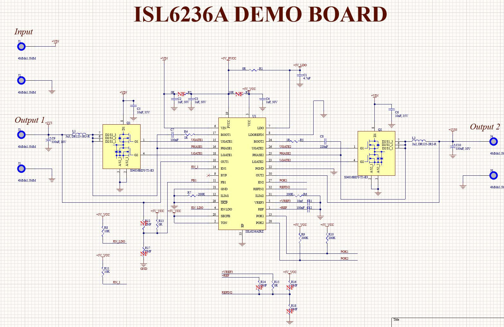

# ISL6236A Power Supply Design

An Altium Designer power supply project built around the **ISL6236AIRZ** controller, developed as part of my hardware design learning through **FEDEVEL Academy**.

The project covers a dual-output power supply from schematic capture through component library creation to PCB layout. It includes custom footprints with hand-defined pads, an ActiveBOM document, and an in-progress PCB layout (revision **V1I1**).

## Schematic Preview

## Design Overview

The schematic includes two switching power stages with external MOSFETs, inductors, and output capacitors, together with the controller's supply, bootstrap, feedback, enable, and power-good connections.

| Item | Design detail |
| --- | --- |
| Main controller | ISL6236AIRZ |
| MOSFETs | SI4816BDY-T1-E3, Q1 and Q2 |
| Output 1 label | +1V5 — nominal 1.5 V target |
| Output 2 label | +1V05 — nominal 1.05 V target |
| Inductors | DR125-3R3-R, 3.3 µH; DR125-2R2-R, 2.2 µH |
| Design software | Altium Designer |
| PCB revision | V1I1 |

The output values above reflect the schematic labels; they are not measured performance results.

## Component Libraries

All symbols and footprints in this project are stored in local libraries rather than pulled from a vendor database.

- **Schematic library** (`ISL6236A_DEMO.SchLib`): symbols with manufacturer and supplier part numbers stored as component parameters.
- **PCB library** (`ISL6236A_DEMO.PcbLib`): footprints built manually, including pad geometry, pad spacing, and component outlines, based on the manufacturers' recommended land patterns.

## Repository Contents

| File | Purpose |
| --- | --- |
| `PCB_Project.PrjPcb` | Main Altium project |
| `ISL6236A_DEMO.SchDoc` | Power supply schematic |
| `ISL6236A_DEMO_PCB_V1I1.PcbDoc` | PCB layout, revision V1I1 (in progress) |
| `ISL6236A_DEMO.SchLib` | Local schematic symbol library and component parameters |
| `ISL6236A_DEMO.PcbLib` | Local PCB footprint library with custom pads |
| `PCB_Project.BomDoc` | ActiveBOM document |
| `Pic/schematic/` | Schematic preview |

## Skills Practiced

- Capturing a power supply schematic in Altium Designer.
- Working with controller, MOSFET, inductor, and passive-component symbols.
- Creating custom PCB footprints and defining pad geometry from datasheet land patterns.
- Preparing and managing local schematic and PCB libraries.
- Recording manufacturer and supplier part numbers in component parameters.
- Organizing component information with ActiveBOM.
- Transferring a schematic to PCB and starting component placement and routing.
- Maintaining hardware design files with Git and GitHub.

## Opening the Project

1. Download or clone this repository.
2. Open `PCB_Project.PrjPcb` in Altium Designer.
3. Open `ISL6236A_DEMO.SchDoc` to inspect the circuit.
4. Open `ISL6236A_DEMO_PCB_V1I1.PcbDoc` to inspect the board layout.
5. Open the `.SchLib` and `.PcbLib` files to inspect the component libraries.
6. Open `PCB_Project.BomDoc` to review the bill of materials.

Keep the project and its associated design files together so relative file references remain valid. The schematic preview above can be viewed without Altium Designer.

## Project Status

**In progress — PCB layout stage (V1I1).**

| Stage | Status |
| --- | --- |
| Schematic capture | ✅ Done |
| Schematic symbol library | ✅ Done |
| Footprint library (custom pads) | ✅ Done |
| ActiveBOM | ✅ Done |
| PCB placement and routing | 🔄 In progress |
| Design-rule check (DRC) | ⏳ Pending |
| Manufacturing outputs (Gerber, drill, pick-and-place) | ⏳ Pending |
| Hardware build and validation | ⏳ Pending |

## Acknowledgments

This is a course-based learning project developed while following FEDEVEL Academy training. Credit for the underlying course design and instructional material belongs to their respective authors. This repository documents my implementation and learning progress.

**Maintained by Feras Abuhaimed**
